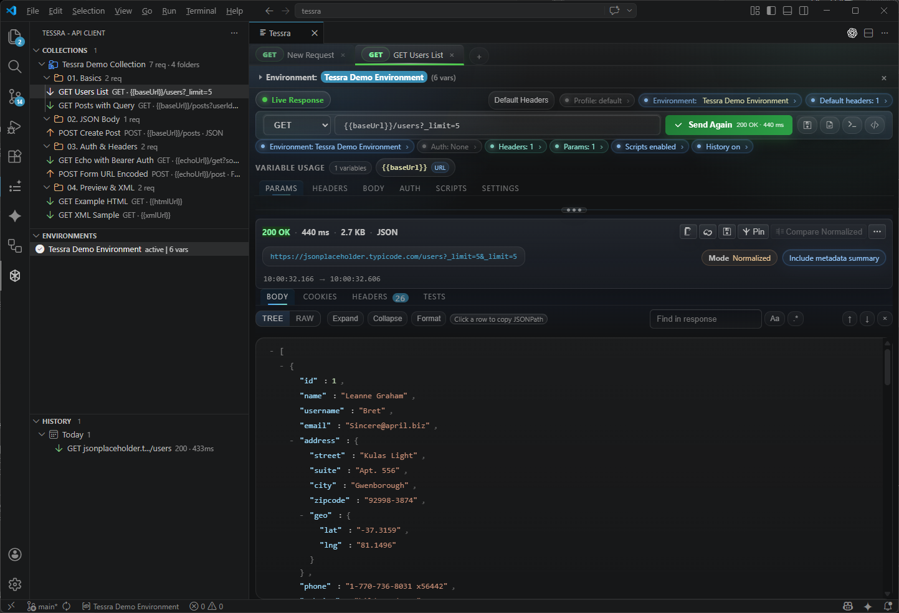
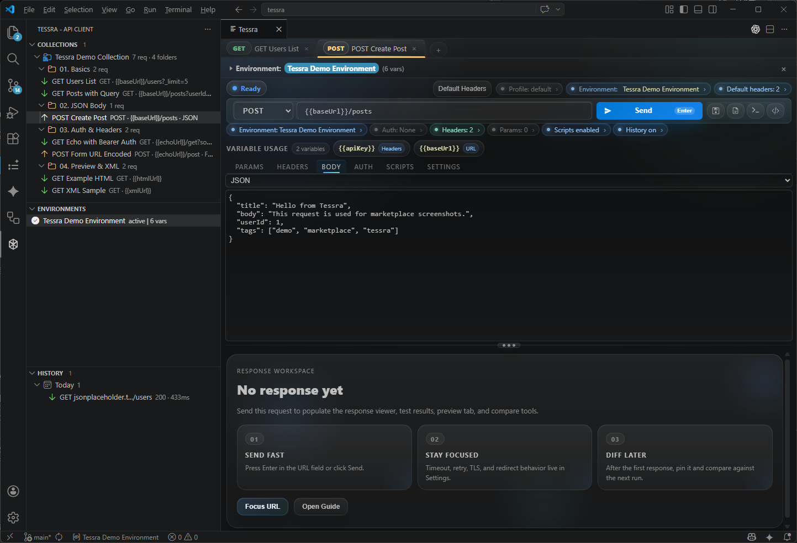
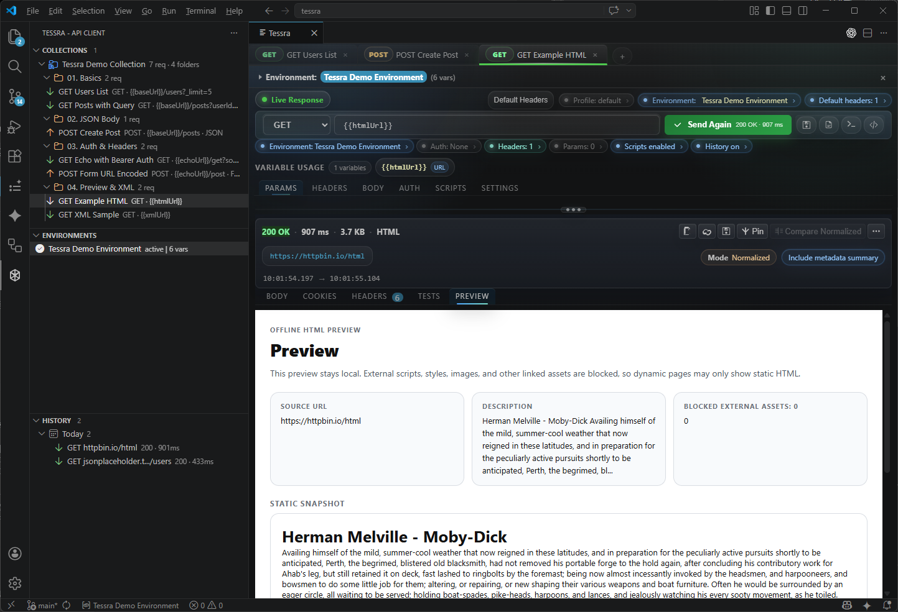
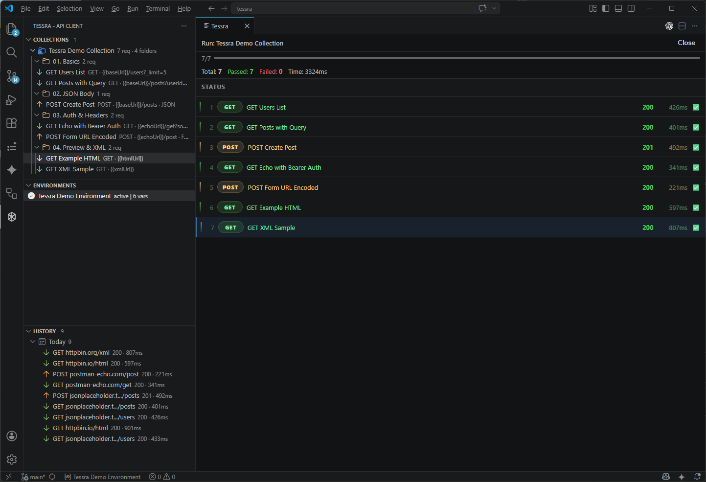

# Tessra

The local-first API client for VS Code.

No login. No cloud sync. No paywalled core workflows.

[Korean README](./README.ko.md)

Tessra is built for developers who want a fast Thunder Client-style workflow inside VS Code without accounts, sync requirements, or pricing gates around everyday features. Data stays on the machine, and network traffic only happens when the user explicitly sends an API request.

## Screenshots

### Main workspace
Collections, environments, variables, history, and the response viewer in one local workspace.



### Compose requests
Build requests with params, headers, JSON bodies, auth, scripts, and environment variables.



### HTML preview
Preview static HTML responses safely inside VS Code.



### History and collection runner
Group request history by date and run collections with status summaries.



## Why Tessra

- Offline-first workflow
- No login required
- No cloud dependency
- Local JSON storage only
- cURL, OpenAPI, and Postman import/export
- Scripts, collections, environments, response compare, and code generation
- WebSocket `ws://` / `wss://` connect and message workflow
- Built on VS Code Webview + TreeView
- Uses Node.js built-in `http` / `https` / `net` / `tls`

## Features

### Request editing
- HTTP methods: `GET`, `POST`, `PUT`, `PATCH`, `DELETE`, `HEAD`, `OPTIONS`
- Multi-tab request editor with pinned tabs
- Re-click the active request editor tab to collapse or restore its body while keeping the tab bar visible
- `Enter` in the URL field sends the request
- `Ctrl+Enter` / `Cmd+Enter` also sends the request
- Cancel in-flight requests without discarding the last good response
- Request stage strip, richer empty states, status-aware response feedback, and polished response actions
- Topline request summary chips for environment, auth, default headers, scripts, and history behavior
- Collapsed-by-default environment variable editor with active environment name and variable count
- Preflight warnings for unresolved `{{variables}}` before you send
- Clickable status chips that jump to the relevant request area, focus it, and briefly highlight the linked card
- Draft change chips that summarize which request sections changed before you save or send
- Variable usage cards that show where each `{{variable}}` is used across the request
- Masked auth and sensitive key/value inputs with reveal controls
- Bulk paste for headers and query params
- Empty-state quick actions for a sample request, the guide, environment switching, and URL focus

### WebSocket
- `ws://` and `wss://` tabs are detected from the URL
- Handshake requests use headers, query params, auth, workspace default headers, environment variables, and TLS override settings
- Connect and disconnect from the primary action; the Body tab acts as the outgoing text message composer
- Inbound and outbound messages render in a dedicated WebSocket log, with inbound binary frames shown as base64

### Request settings
- Timeout per tab
- Follow redirects
- Save to history toggle
- Manage workspace default headers from the request toolbar or Headers tab
- TLS override: `Default`, `Strict`, `Insecure`
- Maximum response size limit
- Retry count and retry delay
- Stop after headers
- Skip default headers
- Disable scripts
- Visual risk highlighting for request-specific settings that change safety or behavior
- Automatically opens Preview when the response contains meaningful static HTML

### Body types
- `none`
- `json`
- `xml`
- `form-urlencoded`
- `form-data`
- `binary`
- `raw`
- Form-data summaries, file chips, and clearer text/file row affordances

### Auth
- No Auth
- Basic Auth
- Bearer Token
- API Key in header or query

### Environments
- Environment CRUD
- Active environment switching
- `{{variable}}` resolution
- Variable autocomplete in URL, headers, body, auth, scripts, and editable text inputs
- Variable resolution for URL, headers, params, body, auth, and file paths
- `Import Environment` from the Environments title bar for Postman Environment JSON files
- Workspace-local storage profiles for isolating collections, history, environments, default headers, and saved tabs

### Collections and history
- Collection / folder / request CRUD
- Drag and drop ordering
- Duplicate / Save As
- Run All Requests
- Live collection runner status with active request highlighting and retry countdowns
- Rerun failed requests only from the collection runner summary
- Collection runner executions are saved to history when each request's Save to history setting is enabled
- Collection filtering with `method:`, `host:`, and `type:` tokens
- History pinning and filtering with `status:`, `method:`, `host:`, and `pinned:` tokens
- History snapshots store the executed request state plus timing metadata
- History pruning via `tessra.historyMaxItems`, with pinned entries preserved
- History Settings action from the History view opens the retention setting directly
- Denser sidebar rows with method/host summaries and collection/folder item counts

### Response viewer
- Body / Headers / Cookies / Tests tabs, plus Preview when the response contains meaningful static HTML
- Dynamic HTML pages stay in Body while `Open URL` remains available for HTTP/HTTPS resolved pages
- Readable response durations with requested/received timestamps in the response metadata
- Sticky response toolbar for finding text, compare, and response actions
- Topline status chips for the active environment, workspace profile, default headers, scripts, and history behavior
- Find text within the response body with next/previous navigation, case-sensitive mode, and regex mode
- JSON tree viewer
- XML formatting with `Pretty`, `Compact`, and `Inline Children`
- Content-Type based syntax highlighting
- Quick copy actions for resolved URL, status line, raw headers, and response body
- Save response body to file
- Response compare with `Raw`, `Normalized`, and `Pretty` modes
- Compare state chips that surface the active mode, metadata summary usage, and pinned response readiness
- Compare settings with ignored headers and ignored JSON paths
- Compare summaries with body line counts and changed / left-only / right-only totals

### Scripts
- Pre-request scripts
- Test scripts
- `pm.test`, `pm.expect`, `pm.environment`
- Imported scripts stay disabled until you explicitly trust them in the request tab
- Script logs and test results
- Pass/fail/log summary badges and first-failure highlighting
- Collapsible in-app script helper stepper plus insertable examples for chaining request 1 response values into request 2

Example flow:

```js
const body = pm.response.json();
pm.environment.set("sessionKey", String(body.key));
```

Then use `{{sessionKey}}` in request 2.

### Import / Export
- cURL import
- Copy as cURL
- OpenAPI import
- Tessra JSON collection import
- Postman collection import / export
- Postman environment import / export

### Code generation
- `fetch`
- `axios`
- `Java HttpURLConnection`

## Install

```bash
npm install
npm run build
npm run package
```

Then in VS Code:

1. Open `Extensions`
2. Click `...`
3. Select `Install from VSIX...`
4. Choose the generated `.vsix` file

## Quick start

1. Open Tessra from the Activity Bar
2. Run `Tessra: New Request` or click `+`
3. Select a method and enter a URL
4. Fill in params, headers, body, auth, scripts, or request settings
5. Click `Send` or press `Enter`
6. Run `Tessra: Import OpenAPI` from the Command Palette to turn an OpenAPI JSON file into a collection

Example variable usage:

```text
URL: {{baseUrl}}/users
Header: Authorization: Bearer {{token}}
Body: {"env":"{{envName}}"}
```

## In-app guide

Run `Tessra: Open Guide` to open the user guide inside VS Code.

## Extension settings

### `tessra.historyMaxItems`
- Type: `number`
- Default: `500`
- Minimum: `50`
- Maximum: `5000`
- Maximum number of non-pinned history entries to keep
- Pinned entries are preserved, so total history count may exceed this limit
- You can open this setting from the History view title bar with `Tessra: Open History Settings`

### `tessra.allowInsecureCertificates`
- Type: `boolean`
- Default: `false`
- Disables HTTPS certificate validation only when explicitly enabled
- Intended for self-signed local development environments

### `tessra.displayLanguage`
- Type: `string`
- Default: `en`
- Supported values: `en`, `ko`, `ja`
- Controls Tessra panels, prompts, notifications, and the in-app guide
- The in-app guide uses localized guide files when available and falls back to English
- VS Code locale still controls Tessra setting labels and Command Palette titles
- This setting changes the Tessra UI itself, separate from the VS Code locale
- You can also run `Tessra: Change Display Language` from the Command Palette

### `tessra.requestPanelTheme`
- Type: `string`
- Default: `default`
- Supported values: `default`, `minimal-cool`, `product`, `bold-color`
- Controls the visual preset used by the Tessra request panel webview
- Available presets: balanced default polish, minimal cool, stronger product feel, and bolder color accents
- You can also run `Tessra: Change Request Panel Theme` from the Command Palette

### `tessra.workspaceProfile`
- Type: `string`
- Default: `default`
- Switches the active local storage profile for collections, history, environments, default headers, and saved tabs
- Use `Tessra: Change Workspace Profile` to switch or create profiles quickly from the Command Palette
- Keep `default` as your everyday workspace, then create a separate profile when another project, imported spec, or experiment should not mix with it
- A good rule of thumb: use profiles for different projects or workflows, and use environments for `local` / `staging` / `prod` inside the same project

## Keyboard shortcuts

- `Ctrl+T`: New request tab
- `Ctrl+W`: Close current tab
- `Enter`: Send request from the URL field
- `Ctrl+Enter`: Send request
- `Ctrl+S` / `Cmd+S`: Save the current request
- `Ctrl+Shift+S` / `Cmd+Shift+S`: Save As
- `Ctrl+F` / `Cmd+F`: Focus response find field
- `Alt+1..6`: Switch request tabs
- `Alt+Shift+1..5`: Switch response tabs

On macOS, use `Cmd` instead of `Ctrl`.

## Local storage

All extension data is stored under VS Code `globalStorage` as JSON files. The default profile stores files at the root, and custom workspace profiles store the same files under `profiles/<profile-name>/`.

- `collections.json`
- `history.json`
- `environments.json`
- `active-environment.json`
- `default-headers.json`
- `variables.json`
- `tab-state.json`

If a stored JSON file cannot be parsed, Tessra keeps a `.corrupt-*` backup beside the original file, warns you, and uses defaults for that file until it is saved again.

Typical locations:

- Windows: `%APPDATA%\Code\User\globalStorage\tessra.tessra\`
- macOS: `~/Library/Application Support/Code/User/globalStorage/tessra.tessra/`
- Linux: `~/.config/Code/User/globalStorage/tessra.tessra/`

## Development

```bash
npm run build
npm run watch
npm test
npm run package
```

Use `F5` in VS Code to launch an Extension Development Host.
Use `docs/manual-e2e-checklist.md` for the manual E2E pass.

## Tech stack

- TypeScript (`strict`)
- VS Code Extension API (`^1.74.0`)
- Node.js built-in `http` / `https`
- Webview + TreeView
- esbuild
- Mocha

## Principles

- No telemetry
- No login
- No cloud sync
- No external CDN in Webview
- Local-first data ownership
